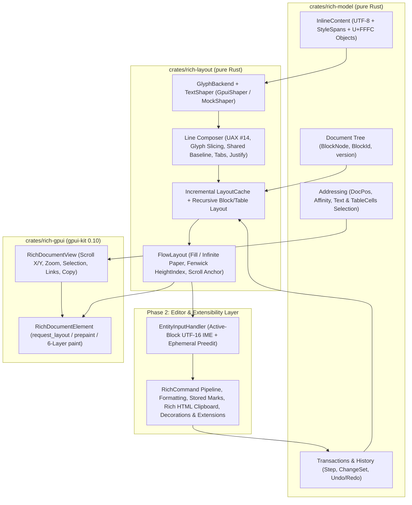

# `gpui-rich` Architecture & Progress

Current baseline: `master` with `rich-gpui` targeting `gpui-kit 0.10` (`default-features = false`, optional `gpui-fast` feature).

---

## 1. Architecture Summary

`gpui-rich` is a non-paginated, Google Docs-style rich text renderer on `gpui-kit` (GPUI), designed around editing invariants so a full rich text editor layers on cleanly in Phase 2 without rewriting the layout or paint pipeline.

### Core Design Decisions

| Area | Implemented Design | Key Files |
| :--- | :--- | :--- |
| **Horizontal Canvas Modes** | Separate `HorizontalLayout::Fill` (edge-to-edge responsive reflow) and `HorizontalLayout::Paper(PaperSpec)` (continuous infinite-length paper sheet with fixed typographic width, centered on a neutral desk backdrop, horizontal scroll when narrower or zoomed in). | `crates/rich-model/src/style.rs`, `crates/rich-layout/src/flow.rs`, `crates/rich-gpui/src/element.rs` |
| **Text Shaping** | Run-segmented line composer over GPUI's native `WindowTextSystem::shape_line`, decoupled behind `GlyphBackend` (`Font` + `Glyph`) and `TextShaper`. Headless tests use `MockShaper`, while GPUI uses `GpuiShaper` with native OS font fallback, emoji, and `OnceLock`-cached monospace font resolution. | `crates/rich-layout/src/shaper.rs`, `crates/rich-gpui/src/shaper.rs` |
| **Document Model** | Hierarchical `BlockNode` tree with monotonic `BlockId` + `version`, normalized contiguous `StyleSpan`s, `\u{FFFC}` atomic inline object sentinels, cached UTF-8/UTF-16 offsets, `DocPos` + `Affinity`, `DocumentSelection` (`Text` & `TableCells`), `RichCommand` / `CommandOutcome`, and `Transaction` / `Step` + `History` undo/redo. | `crates/rich-model/src/block.rs`, `crates/rich-model/src/inline.rs`, `crates/rich-model/src/selection.rs`, `crates/rich-model/src/command.rs`, `crates/rich-model/src/transaction.rs` |
| **Command Pipeline** | Every viewer and editor interaction flows through `RichCommand` dispatched at `RichDocumentView::dispatch_command_with_source`, backed by `gpui_kit::actions!` (`rich_document::*`), `"RichDocument"` key context, `register_default_keybindings`, `InteractionPolicy` + `CommandSource` gating, `CommandMiddleware`, `EventEmitter<RichDocumentEvent>`, and `Transaction` + coalesced `History`. | `crates/rich-model/src/command.rs`, `crates/rich-gpui/src/view.rs` |
| **Mixed-Baseline Line Composer** | Batches uniform `(font_size, baseline_shift, bidi_level)` runs, wraps with `unicode-linebreak` (UAX #14) plus UAX #29 emergency grapheme breaking, slices shaped glyph runs, resolves tab stops, computes shared baselines for mixed sizes/sub/sup/inline boxes, and applies Left/Center/Right/Justify alignment. | `crates/rich-layout/src/line.rs` |
| **Virtualization & Flow** | Incremental `LayoutCache` keyed by `(BlockId, version, quantized_width, quantized_zoom)`, Fenwick tree `HeightIndex` (`O(log N)` prefix sum, updates, and `index_at_y`), margin collapsing, collapsible headings, and `(BlockId, local_y_offset)` scroll anchoring. | `crates/rich-layout/src/block.rs`, `crates/rich-layout/src/flow.rs` |
| **GPUI Canvas & Interaction** | Single unified `RichDocumentElement` (`gpui_kit::Element`) painting 6 strict z-order layers (`paint_quad`, `paint_shadows`, `paint_glyph`, `paint_emoji`, `paint_underline`, `paint_strikethrough`), hosted by `RichDocumentView` with vertical + horizontal scrolling, anchored zoom, clickable links, and recursive selection/copy. Compatible with `gpui-kit` apps (both default `gpui-pre` and `gpui-fast` backends). | `crates/rich-gpui/src/element.rs`, `crates/rich-gpui/src/view.rs` |

### System Data Flow

### Paint Layer Z-Order (`RichDocumentElement`)

| Layer | Painted Content |
| :--- | :--- |
| **0. Canvas & Paper** | Fluid white canvas (`Fill`), or neutral desk `#eef2f6` + continuous infinite-length white paper sheet with border and `BoxShadow` (`Paper`). |
| **1. Block Chrome** | Table cell fills and borders, blockquote accent bar, code block rounded frame and language tag, horizontal rule, list gutter markers (vector quads for checklists), heading collapse chevrons (`▾`/`▸`). |
| **2. Selection** | Translucent blue text selection rects (across top-level, blockquote, and table leaf blocks) and rectangular `TableCells` grid highlights. |
| **3. Inline Backgrounds** | Text highlight colors and rounded inline code pills. |
| **4. Foreground Content** | Monochrome glyphs, color emoji, solid and wavy underlines, strikethroughs, smart chip pills, inline image placeholders, footnote refs, and optional debug baseline/line-rect overlay. |
| **5. Overlays & Scrollbars** | Active caret sized to local font metrics, vertical scrollbar thumb, and horizontal scrollbar thumb when `canvas_width > viewport_width`. |

### Host Application Integration & Command Boundary

`gpui-rich` owns core document commands and GPUI actions while keeping keymap policy, chrome, and app-level workflows decoupled for the consuming `gpui-kit` application:

* **Owned by `gpui-rich`**:
  * Unified `RichCommand` enum (`crates/rich-model/src/command.rs`) with stable dot-namespaced `command_id()` values, `is_document_mutation()` guards, and `CommandSource` (`User` vs `Programmatic`).
  * `InteractionPolicy` (`editable`, `selectable`, `clickable_links`, `collapsible_headings`, `show_caret_read_only`) with presets (`editable()`, `viewer()`, `static_preview()`) controlling UI affordances and `CommandSource::User` gating.
  * `RichDocumentView::dispatch_command` (`crates/rich-gpui/src/view.rs`) as the single execution seam backed by `Transaction` and coalesced `History`. `CommandSource::User` mutations require `policy.editable`, while `CommandSource::Programmatic` commands execute through middleware, `Transaction`, `LayoutCache`, and host events even when the UI is in view-only mode.
  * Three-layer editing input model:
    * `gpui_kit::actions!` (`rich_document::*`) scoped to `"RichDocument"` for structural, navigation, and formatting keys (`Enter`, `Backspace`, `Delete`, `Tab`, arrows, `Ctrl/Cmd+B`, `Ctrl/Cmd+Z`), plus an opt-in `register_default_keybindings(cx)` helper.
    * `EntityInputHandler` for all text entry and IME. Uncommitted composition preedit stays ephemeral on the view (outside `Document` and `History`). Committed text dispatches `RichCommand::InsertText` (or range replacement) with `CommandSource::User` so `InteractionPolicy`, Markdown input rules, and host events run uniformly.
    * `History` coalescing groups sequential typing bursts into single undo entries so Undo reverts words or typing bursts cleanly.
* **Owned by the consuming host app**:
  * Application chrome (toolbars, menus, outline sidebar, slash menus, command palette) built with `gpui-kit` / `gpui-component` and dispatching `RichCommand` or GPUI actions.
  * Keymap customization (either calling `register_default_keybindings(cx)` for defaults, or binding custom app keymaps / Vim modes directly to `rich_gpui::*` actions or `dispatch_command`).
  * App-level commands (Save, Export, File Open, Comments, AI actions) composed over `RichCommand` and `Transaction`.

### `gpui-kit` Integration

* `crates/rich-model` and `crates/rich-layout` remain pure Rust with zero GPUI or `gpui-kit` dependencies.
* `crates/rich-gpui` depends on `gpui-kit = { version = "0.10", default-features = false }` (pulling GPUI core and `gpui-base` while keeping `gpui-component` and `gpui-kit-assets` optional for the host app) and exposes a `gpui-fast` feature forwarding `gpui-kit/gpui-fast`.
* Actions use `gpui_kit::actions!` so `rich-gpui` works identically under both default `gpui-pre` and `gpui-fast` backends.
* **Native Code Blocks & Reference Architecture**: `BlockKind::CodeBlock` stays native to `rich-layout` and `RichDocumentElement` so documents retain unified cross-block selection, a single `Transaction`/`History` undo stack, pure-Rust layout virtualization, and minimal `gpui-kit` feature requirements. Syntax highlighting attaches via `DecorationProvider` on Layer 4. `gpui-kit`'s editor implementation (`gpui-base/src/input/` for IME, caret blinking, navigation, selection, gutters, and decorations, and `gpui-component/src/highlighter/` for `syntect`/`tree-sitter` highlighting) serves as an architectural reference for Phase 2 editing and code block enhancements.

### Extensibility Architecture (3 Core Seams)

`gpui-rich` stays fast for built-in prose while exposing three structured extension seams for the consuming application:

1. **Theming & Host Events (`RichTheme` + `EventEmitter<RichDocumentEvent>`)**:
   * Replace hardcoded paint colors with a `RichTheme` token struct (Light, Dark, custom app themes, plus an adapter syncing from `gpui_kit::base::Theme` covering desk backdrop, paper surface, borders, text, muted chrome, links, selection tint, caret, code frames, blockquote rails, and smart chip palettes).
   * Emit `RichDocumentEvent` (`LinkActivated`, `SelectionChanged`, `DocumentMutated`, `CommandExecuted`) via GPUI `EventEmitter` so the host app subscribes with `cx.subscribe(...)` to route internal URIs (`doc://...`, `#section`), sync toolbar formatting states, and track dirty state.
2. **Ephemeral Decoration Providers (`DecorationProvider`)**:
   * Compute transient visual overlays at layout/paint time without mutating `Document` or polluting Undo `History`.
   * Feeds existing paint layers directly: Layer 2 (find-in-document and comment highlights), Layer 4 (code block syntax highlighting colors and spellcheck wavy underlines), and Layer 5 (AI ghost text and remote collaborator carets).
3. **Custom Node Extensions & Command Middleware (`ExtensionRegistry` + Plugins)**:
   * Add typed escape hatches on the model: `BlockKind::Custom { kind, data }`, `InlineObject::Custom { kind, data }`, and `RichCommand::Custom { id, payload, mutates_document }`.
   * Register `NodeExtension` handlers per `kind` for layout measurement (`measure_block` / `measure_inline`), rendering (direct paint or hosted interactive GPUI `AnyElement` / `Entity` children positioned at computed rects), and plain-text/HTML clipboard fallback.
   * Support command middleware (`before_command(&command, source, &document, &selection)` -> `Continue | Cancel | Replace(RichCommand)` and `after_transaction(&ChangeSet)`) to implement Markdown input rules (`# `, `- `, `` `code` ``), read-only region locks, selective view-mode command filtering, auto-save debouncing, and future CRDT sync.

---

## 2. Implementation Progress

### Phase 1: Non-Paginated Renderer & Interactive Viewer (Complete)

* [x] Workspace setup (`Cargo.toml`, `AGENTS.md`).
* [x] **`rich-model`**: `Document`, `BlockNode`, `StyleSheet`, `InlineStyle` / `ResolvedTextStyle`, `InlineContent` with normalized spans and `\u{FFFC}` embeds, UTF-8/UTF-16 mapping, `DocPos` / `Affinity` / `DocumentSelection`, `RichCommand` / `CommandOutcome` (stable `command_id` + `is_document_mutation`), `Transaction` / `Step` / `History`, JSON serialization, and `Document::collect_leaf_blocks`.
* [x] **`rich-layout`**: `GlyphBackend` + `TextShaper` + `MockShaper`, mixed-font-size and superscript/subscript shared-baseline line composer, UAX #14 wrapping, glyph cluster slicing, emergency grapheme breaking, tab stops, Left/Center/Right/Justify alignment, recursive `Blockquote` and `Table` layout, `LayoutCache`, Fenwick `HeightIndex`, collapsible headings, `ScrollAnchor`, `HorizontalLayout::Fill` vs `Paper(PaperSpec)`, and recursive leaf hit-testing / caret / selection geometry.
* [x] **`rich-gpui`**: `GpuiShaper` (with cached monospace font lookup), `RichDocumentElement` (6-layer painter, infinite-length paper sheet chrome, vector checklist boxes, debug baseline overlay, vertical & horizontal scrollbars), and command-driven `RichDocumentView` (`dispatch_command`, GPUI `actions!` under `"RichDocument"` key context, `register_default_keybindings`, `read_only` guard, `History` undo/redo, vertical/horizontal wheel & `Shift+Wheel` scrolling, anchored zoom 50% to 200%, collapsible heading toggle, clickable links with `PointingHand` cursor, click/double-click/drag selection across paragraphs, blockquotes, and tables, `SelectAll`/`ClearSelection`, automatic `TableCells` rectangular grid promotion, plain-text & TSV clipboard copy).
* [x] **`examples/docs_viewer`**: Showcase app (`examples/docs_viewer/src/main.rs`) with `Paper`/`Fill` mode switch, `Narrow`/`Letter`/`Wide` sheet presets, zoom controls, debug baseline toggle, and sample document exercising every block and inline primitive.
* [x] Headless invariant tests (7/7 passing across `rich-model` and `rich-layout`).

---

### Phase 2: `gpui-kit` Migration, Extensibility Foundations & Core Rich Text Editor (Complete)

* **2.0 `gpui-kit` Migration** (Complete):
  * [x] Migrate `crates/rich-gpui` to `gpui-kit = { version = "0.10", default-features = false }` with optional `gpui-fast` feature passthrough and `gpui_kit::actions!`.
  * [x] Migrate `examples/docs_viewer` to `gpui-kit` application lifecycle (`gpui_kit::application()`, `gpui_kit::init(cx)`, `gpui_kit::open_window(...)`).
* **2.1 Host Integration, Policy & Theming** (Complete):
  * [x] `InteractionPolicy` (`editable`, `selectable`, `clickable_links`, `collapsible_headings`, `show_caret_read_only` + presets `editable()`, `viewer()`, `static_preview()`) and `CommandSource` (`User` vs `Programmatic`) gating.
  * [x] **Extensibility Seam 1**: `RichTheme` (Light/Dark/custom tokens + `gpui_kit::base::Theme` sync) and GPUI `EventEmitter<RichDocumentEvent>` (`LinkActivated`, `SelectionChanged`, `DocumentMutated`, `CommandExecuted`).
  * [x] Command middleware hooks (`before_command` with `CommandSource` and `after_transaction`).
* **2.2 Core Editing & Navigation** (Complete):
  * [x] Container-aware `Transaction` steps for nested block split, merge, insert, remove, and kind conversion.
  * [x] Caret blinking timer and keyboard navigation (Left/Right grapheme steps, Word steps, Up/Down with `goal_x`, Home/End, `Shift` selection extension, cross-block movement).
  * [x] `EntityInputHandler` on `RichDocumentView` (active-block UTF-16 scoping, `bounds_for_range` IME popup positioning, ephemeral preedit underline, committed text routed via `RichCommand`).
  * [x] Core editing commands routed through `RichCommand` -> `Transaction` + coalesced `History` (`InsertText`, `Backspace`/`Delete` including cross-block merge, `Enter` block split, `Shift+Enter` soft break, `Tab`/list indent & outdent, `Ctrl/Cmd+Z` and `Ctrl/Cmd+Shift+Z` undo/redo).
* **2.3 Formatting & Rich Clipboard** (Complete):
  * [x] `Selection::stored_marks` and formatting commands/shortcuts (`Ctrl/Cmd+B`, `I`, `U`, `E`, `Shift+X`, inline code, links, headings, lists, alignment, and live toolbar query helpers).
  * [x] Rich clipboard support (`ClipboardFragment` `text/html` + `text/plain` extraction, normalized HTML parsing/sanitization, and atomic multi-block paste via `RichCommand::PasteHtml`).
* **2.4 Decorations & Custom Extensions** (Complete):
  * [x] **Extensibility Seam 2**: `DecorationProvider` (`InlineDecoration` + `OverlayDecoration`) feeding Layers 2, 4, and 5 (find/comment highlights, per-glyph syntax foreground overrides, spellcheck underlines, ghost text, remote carets).
  * [x] **Extensibility Seam 3**: `BlockKind::Custom`, `InlineObject::Custom`, `RichCommand::Custom`, `NodeExtension`, and `ExtensionRegistry` (including hosted interactive GPUI `AnyElement` children and direct immediate-mode paint callbacks).

### Phase 3: Advanced Google Docs Capabilities (Complete)

* [x] Interactive checklist clicking (`Step::ToggleChecklist`, `RichCommand::ToggleChecklistItem`), async `AssetProvider` (`MemoryAssetProvider`, `FileAssetProvider`) with background image/SVG decoding painted via `window.paint_image`, 4-corner inline image drag-resize handles (`Step::UpdateInlineObject`, `RichCommand::ResizeInlineImage`), and built-in interactive widgets (smart chip floating popovers and code block `Copy`/`Copied` buttons).
* [x] Interactive table editing: column divider hover/drag resizing (`hit_test_table_column_border`, `RichCommand::SetTableColumns`), Tab/Shift+Tab cell navigation (appending a new row when tabbing past the final cell), and span-aware row/column insert, delete, merge, and split transactions with full Undo/Redo (`InsertTableRow`, `DeleteTableRow`, `InsertTableColumn`, `DeleteTableColumn`, `MergeTableCells`, `SplitTableCell`).
* [x] Full Unicode BiDi (`unicode-bidi` UAX #9 embedding level analysis, BiDi run splitting across `GpuiShaper` and `MockShaper`, L1/L2 visual fragment reordering, RTL hit-testing, and disjoint multi-run BiDi selection rectangles).
* [x] Pluggable `DocumentCodec` (`CodecRegistry`, `MarkdownCodec`, `HtmlCodec`, `JsonCodec`) and optional CRDT sync (`CrdtSyncBridge`, `SyncDelta`, `SyncTransport`, fractional `OrderKey` LWW-Element-Set with tombstones) over `CommandMiddleware::after_transaction`.

### Document editing contracts

* **Clipboard and grids:** `ClipboardFragment` distinguishes open text edges from block boundaries and preserves whole tables and containers. New inline copies receive destination-local identities; inverse edits restore the original identities. Grid selections use visual coordinates and expand to include intersecting merged cells. Rectangular paste overwrites occupied cells only when the source matches the destination’s span boundaries; it does not grow the table.
* **Go To and Find:** `RichCommand::Navigation` targets exact positions, headings, adjacent paragraphs/tables, and visual cells. Reveals measure the actual caret and scroll both axes without editing history. Find is visible-only by default, wraps in reading order, and supports literal or regex queries. Replace All is one undoable transaction; replacements are literal and cannot cross inline objects.
* **Components:** `RichCommand::Component` edits document-owned dropdown choices and variable values. Dropdown selection is per chip; variable values are shared. Rich clipboard imports definitions into the destination document. Captured building blocks insert independent editable nodes in one transaction. Placeholder and table column kinds cover dates, people, and files; `TableBlock::cell_column_mismatches` is advisory and never rejects typing or paste.
  `BuildingBlock::task_tracker` provides a native editable table recipe with a caller-supplied status dropdown, assignee, and due date.
* **Structure and references:** Sibling paragraph moves preserve IDs, and ordered lists support explicit restart and continuation. Grid commands include row and column moves, stable body-row sorting, and cell subdivision. Bookmarks map through edits. Pageless footnotes keep editable end-of-document bodies and derive reference numbers from reading order; clipboard HTML exports a readable superscript rather than a live note.
* **Input rules:** Hosts opt in via `RichDocumentView::with_input_rules`. Typing `- ` or a positive decimal marker such as `3. ` at the start of an empty paragraph converts it to a list. Immediate Backspace restores the literal trigger.
